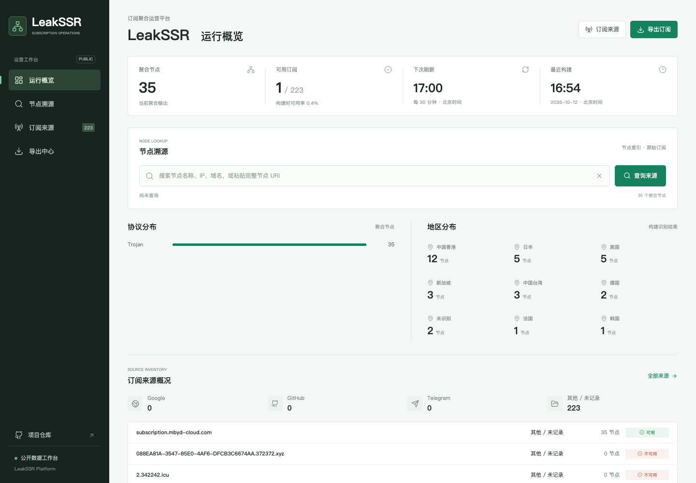

# LeakSSR Platform

公开订阅聚合与节点溯源工作台。正式部署地址：**[leakssr.coinexo.top](https://leakssr.coinexo.top/)**

[GitHub](https://github.com/henryli777/leakssr-platform) · [部署说明](DEPLOYMENT.md) · [支持项目](https://support.coinexo.top/?project=leakssr) · [Apache-2.0](LICENSE)



## 平台能力

- 运行概览：已采集节点、真实连通性通过节点、采集与实测时间、失败与未验证状态。
- 真实检测：Mihomo 逐节点访问两处 HTTPS 204 地址，全部通过才进入订阅导出；显示实测延迟、位置与时间。
- 节点溯源：按名称、域名/IP、服务器端口、UUID 片段或完整 URI，反查全部已采集订阅来源。
- 来源管理：状态/协议/渠道筛选、排序、分页、CSV 导出、每源详情和节点下载。
- 订阅导出：通用 URI 与 Clash Provider，可按协议和订阅标签识别的地区分类。
- 每 30 分钟刷新并实测；原子发布快照，来源全失败时保留旧溯源记录并标记过期，停止发布节点导出。

完整 URI 按连接配置匹配，忽略显示名称和参数顺序。多个关键词按同时包含搜索。
同一服务器上的不同凭据不会合并，一个节点出现在多个订阅时保留所有来源。
查询仅覆盖本平台已采集的数据，不能凭空推算未采集过的订阅链接。

## 本地运行

需要 Python 3.11+ 与 Mihomo；Node 仅用于运行前端单元测试。生产检测内核为 Mihomo v1.19.29。

```sh
python3 -m venv .venv
.venv/bin/pip install -r requirements-platform.txt
.venv/bin/python platform_build.py --output-dir dist
.venv/bin/python platform_refresh.py --output-dir dist --sources data/live_urls.json --mihomo-binary /path/to/mihomo --vantage-point local
.venv/bin/python -m http.server 8765 --directory dist --bind 127.0.0.1
```

打开 `http://127.0.0.1:8765/`。刷新不需要 SerpAPI 密钥，不触发爬虫或通知。
`data/live_urls.json` 是从原公开项目导入的候选列表，不保证当前全部有效。
首次全失败时展示空数据；已有快照时仅保留旧溯源记录，停止节点导出并明确提示刷新失败。
缺少 Mihomo、内核启动失败或无法验证 HTTP 状态时，节点标为未验证，不会回退到 TCP 检测或虚构延迟。

```sh
.venv/bin/python node_lookup.py 'example.com:443'
.venv/bin/python node_lookup.py 'vless://UUID@example.com:443?security=tls#名称' --json
.venv/bin/python -m unittest discover
node --test test_node_search.js
```

## 输出与边界

| 文件 | 用途 |
| --- | --- |
| `sub/all.txt` | 去重且通过本次连通性检测的节点 URI |
| `sub/all.yaml` | Clash/Mihomo 节点 Provider，不是完整客户端配置 |
| `sub/proto/*.txt`、`sub/clash/*.yaml` | 协议分类 |
| `sub/regions/*/` | 按节点名称识别的地区分类，不代表地理 IP 检测 |
| `sub/urls.txt` | 含本次通过节点的原订阅链接，原订阅自身可能含未通过节点 |
| `sub/providers/*.txt` | 每来源中通过本次检测的节点 URI |
| `sub/node_index.json` | 全部已采集节点、多来源反查索引与逐节点检测证据 |
| `sub/url_meta.json`、`health.json` | 来源状态与构建健康信息 |

支持 `ss`、`ssr`、`vmess`、`vless`、`trojan`、`hysteria2` URI，支持原文和 Base64 订阅。
支持保守导入 Clash YAML 内联节点的常见 SS/Trojan/VMess/VLESS/HY2 配置；
不会执行规则或远程 providers，不支持的插件、传输、带宽与扩展字段会跳过。
无法无损转换的原始 URI 仅保留在反查索引中，
标记不支持验证，不进入任何节点导出；`yaml_skipped_total` 单独报告。
订阅采集成功只表示能读取解析，不等于节点可用。检测通过表示在所示时间、检测位置，
经该节点实际请求 `https://www.gstatic.com/generate_204` 与 `https://cp.cloudflare.com/generate_204`
均得到 HTTPS 204；使用内核的每地址状态历史核验响应，不能仅凭返回一个延迟判定通过。
每次请求超时 8000ms；延迟显示两次成功请求中的较大值，不是下载带宽。
这不保证所有网站、所有客户端或所有网络可用；节点可能在检测后失效，请以最新检测时间为准。

这是公开数据平台，订阅 URL 和节点凭据在输出中可见。只使用允许公开分发的来源，
不要把私人订阅、密钥、SSH 凭据或管理接口上传到仓库或公网。

## 部署

平台运行于 `43.108.37.222`，Nginx 提供静态页面，独立受限 systemd 服务定时刷新。
源代码与虚拟环境由 root 持有，服务只可写公开生成数据；发布采用独立目录与原子切换。
详见 [DEPLOYMENT.md](DEPLOYMENT.md)。GitHub 仓库主页链接指向正式域名，
域名由服务器托管，不与 GitHub Pages CNAME 混用。

## 来源

由 [henryli777/google_ssr_actions](https://github.com/henryli777/google_ssr_actions) 迁移演进，
初始导入提交 `728a8c21ab3f414e4fef4cae36c82dfe518b20ae`，保留 Apache-2.0 许可证。
新仓库只发布平台运行、页面、测试与部署文件；原采集器及历史样本继续保留在父项目
`google_ssr_actions/` 中。Lucide 0.468.0 的 ISC 许可证位于 `static/vendor/LICENSE`。

候选列表另外包含主动公开发布订阅的 [free-nodes/v2rayfree](https://github.com/free-nodes/v2rayfree)、
[ermaozi/get_subscribe](https://github.com/ermaozi/get_subscribe) 与 [free18/v2ray](https://github.com/free18/v2ray)。
平台不把上游的“免费”或“reachable”标签当成可用证明，全部经过同一套本地实测。
